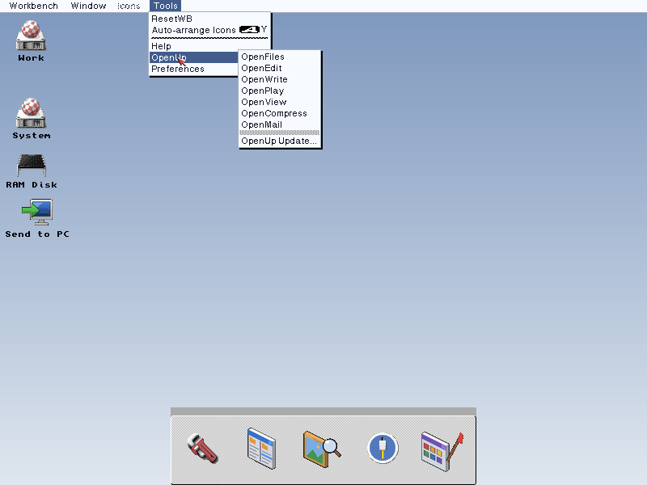
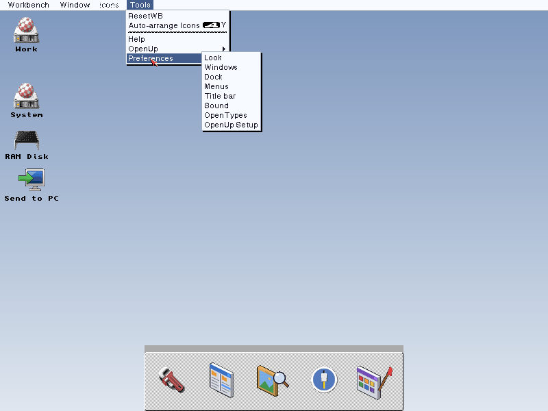

# OpenUp: design

We, 4 October 2026:
- "one 'upgrade' or some cool name for us installing it on a base 3.2.3
  install"
- "so it's: install 3.2.3, run our 'upgrade' or 'unifier' or 'extender' pack"
- "and it's ready to boot on a PiStorm, our appliance, real Amiga"

This is the Open family as one thing a user installs: the platform of
`OPEN_SDK_DESIGN.md`, and the mission test, delivered.

## 1. The promise

1. Install AmigaOS 3.2.3 as Hyperion ships it (the user's own copy).
2. Run one Installer from the pack.
3. Reboot. RTG works on every monitor, and so do the network, MUI programs,
   printing, mail, archives and file types, with nothing more to read.

**The same pack** works on a real Amiga (with whatever cards it has), on a
PiStorm (Emu68), in an AmigaChrome instance, and on the appliance.

## 2. What it finds, and what it installs

| Machine | Found by | Display | Network | Also |
| --- | --- | --- | --- | --- |
| AmigaChrome instance, the appliance | Dalsin $DA15 boards in expansion.library's list: ACRTG (product 9), the OpenSocket card (6), ACStorage | OpenRTG with `ACRTG.card`, `ACRTG.chip` and OpenGPU's `ACRTG.gpu` | OpenSocket's host backend | accontrol: the shared clipboard, files and pace |
| PiStorm | Emu68's own resources | The PiStorm's RTG through OpenRTG once its driver exists; until then the installed Picasso96 stays. VideoCore later for OpenGPU and OpenMedia | OpenSocketDirect over `wifipi.device` or `genet.device` | |
| A real Amiga | The boards in expansion.library's list, the CPU and FPU, the chipset | OpenRTG where it has a driver for the card, and AGA through OpenRTG's AGA card; otherwise the installed Picasso96 or CyberGraphX stays | OpenSocketDirect over the card's SANA-II driver, or the installed Roadshow or AmiTCP if the user keeps it | |

**The rest is the same everywhere:**
- `zunemaster.library`, plus the `muimaster.library` passthrough where no MUI
  is installed;
- OpenGadTools' classes and the look;
- OpenPrint and OpenView, OpenTypes, OpenCompress, OpenMail, and OpenBrowser
  when it's ready;
- the SDL and Mesa runtime libraries.

AmiSSL is another project's: the Installer offers it as it is published,
with its notices.

## 3. Rules

- **The base OS stays as shipped.** The pack adds. Anything it replaces goes
  to `SYS:Storage/OpenUp-Superseded`, listed in a log, and one uninstaller
  puts everything back.
- **It never overwrites another stack, RTG system or MUI without asking.**
  These are the rules of OpenSocket, OpenRTG and OpenMUI.
- **Novice and Expert.** A Novice user gets the recommended answer to every
  question; an Expert sees each choice.
- **An icon that is already there keeps its default tool.** OpenUp offers
  OpenView for pictures, text, guides and documents through OpenTypes' kinds
  of file (the default icons, `ENVARC:Sys/def_<kind>`; `OpenTypes SWITCH`
  without `IN`), never by rewriting the `.info` files of existing files. 0.6.14
  to 0.7.0 did (`SWITCH ... IN SYS:`, with an OpenTypes bug that changed about
  40 of 3.2.3's own icons: datatype descriptors, pointer presets, DOSDrivers,
  Picasso96 guides, Help). `OpenUpTool FIXTOOLS <table> [ALL]` puts them back,
  once, in 0.7.1's upgrade: an icon is changed only if its default tool is
  OpenView now and its original is known, from OpenTypes' own record
  (`ENVARC:OpenTypes/Changes` and the icons it kept in `Backup`) first, else
  from `pack/StockDefaultTools` (names and tool strings of 3.2.3's icons, made
  by `tools/stock_default_tools.py` from a clean install). The kinds of file
  that named MultiView stay on OpenView (that is the offer); `ALL`, which
  UNINSTALL gives, puts those back too. `ENVARC:OpenAmiga/DefaultTools-repair.log`
  says what changed; `DefaultTools-repaired` marks that it ran.
- **Startup changes are marked.** They go in a marked block in `S:User-Startup`.
  The one exception is `C:OpenRTG`, early in `S:Startup-Sequence` on
  machines whose board has no boot ROM. It too is marked, with the old file
  kept.
- **Re-running a newer pack upgrades in place.** A manifest in
  `ENVARC:OpenAmiga/` lists what is installed, with versions; ACBuild's
  AmigaChrome Tools tab can read it.
- **Errors say what to do next,** in plain words (the mission test).
- **Every app and prefs editor has an animated GlowIcon,** drawn and
  shipped as [ICONS.md](ICONS.md) sets out.

## 4. Where it ships

- **Aminet:** one LhA archive.
- **Real machines:** an ADF and an HDF.
- **AmigaChrome:** the Dalsin tools drive in instances, and Cradle's recipes
  for new OS 3.2.3 instances. Instances and real machines get the same pack.
- **The appliance:** its first build carries it, demonstrating every Open
  standard.

## 5. Phases

| Phase | Delivers | Done when |
| --- | --- | --- |
| 1 | The Installer, machine detection, the manifest and the uninstaller; OpenUp Setup with the startup switches (section 6); what is ready now: OpenSocket, OpenPrint and OpenView, and accontrol's tools in AmigaChrome | A fresh OS 3.2.3 scratch copy, plus the pack, prints and reaches the network after one reboot; the uninstaller returns it to clean. **0.1 done, 5 October 2026, for AmigaChrome instances, with OpenLook too (`docs/history/VALIDATION.md`); Setup and the startup switches are next** |
| 2 | Each Open part as it lands: OpenRTG, `zunemaster.library` and the passthrough, OpenGadTools, OpenTypes, OpenCompress, OpenMail, OpenBrowser | Each works after the pack is re-run |
| 3 | PiStorm and real-Amiga detection, with testers' hardware | The same pack on a PiStorm and on a real A1200 with an RTG card |
| 4 | Cradle's OS 3.2.3 recipe applies the pack; the appliance ships it | A new instance from Cradle comes up with the Open family |
| 5 | OpenUp Update (section 6); OpenStart if we say yes. OpenUp Picks is no longer a requirement (the Team, 8 October 2026) | A pack installed today updates itself on request. **Update built (OpenUpTool UPDATE, Cradle's side live, 8 October 2026); the GitHub step is next** |

**Name and repository:** OpenUp (We, 4 October 2026: "OpenUp it is"),
`DalsinAI/openamigaup`.

## 6. What AmiKit tries to be, in OpenUp

We, 4 October 2026: "I would like a lot of what AmiKit tries to be, to be
part of OpenUp".

**What AmiKit is.** Jan Zahurancik's AmiKit (since 2005, now AmiKit X13;
commercial, by subscription) turns the user's own AmigaOS 3.x into a modern,
good-looking desktop with over 400 programs installed and set up.
- **Where it runs:**
  - in WinUAE or Amiberry on Windows, macOS, Linux and the Raspberry Pi;
  - from a bootable USB stick;
  - on a PiStorm: an A1200 with a PiStorm32-lite and a Pi 4, on OS 3.2 with
    the 3.2.2.1 hotfix and Picasso96 2.0.
- **The user supplies** the Kickstart and AmigaOS.
- **Updates** come by its LiveUpdate.

**What it tries to be:** an Amiga that is beautiful and ready the moment it
starts, kept up to date, with nothing to hunt for. That is our mission too,
and it's the part we take.

| AmiKit | OpenUp | |
| --- | --- | --- |
| Everything set up out of the box | One Installer on the user's own OS 3.2.3; a Novice gets the recommended answer to every question | Take |
| AmiKit Setup, a first-boot app for settings | **OpenUp Setup**, a GadTools app that runs once at first boot. It sets the theme, the screen mode (with OpenRTG's boot to RTG), the network on or off, the printer, and which programs to add. It stays in Prefs to run again | Take |
| Morpheuz's Startup Manager: each patch on or off | **Startup switches** in OpenUp Setup: every line OpenUp put in its marked startup block, in plain words, each with a switch that cleanly takes it out | Take |
| Visual themes, Dark mode, a 32-bit desktop, FullHD wallpapers | OpenGadTools' themes (Classic, Open in the OS 4 style, Graphite in the AmiKit style, Retro; Open and Graphite light or dark, with simple gradient backgrounds; its THEME_SPEC.md), and its Theme Builder in Utilities for making your own on a true-colour desktop from boot (OpenRTG `RESIDENT`), with AGA and four-colour forms. Our own art and wallpapers | Take, our way |
| A dozen overlapping look patches (VisualPrefs, Birdie, MCP, MagicMenu and more) | One look in OpenGadTools, one prefs page, "off is off" | Ours is simpler |
| Antialiased TrueType (TTEngine, AfA_OS) | OpenGadTools' smooth text (its section 2b), or AAText until that is ready | Take |
| DualPNG icons with their own icon.library | GlowIcons-style colour icons for everything, on OS 3.2's own icon.library | Ours |
| Directory Opus 5 in place of Workbench | OpenFiles beside Workbench; making it the default for drawers is a switch, off by default | Ours |
| AmiStart start menu (six designs) and a Mini Launcher | To decide: question 1 below | Ask |
| Registered MUI 5, under AmiKit's own licence | OpenMUI: MUI programs run through Zune with nothing to buy. A user's own MUI is left alone | Ours, free |
| 400+ programs installed | ~~OpenUp Picks~~: no longer a requirement (the Team, 8 October 2026). OpenUp installs the Open family only; other programs stay the user's choice | Not taken |
| FPU builds swapped for non-FPU ones | The Installer picks each program's build for the CPU and FPU it finds (section 2) | Take |
| LiveUpdate, by subscription | **OpenUp Update**, free: it checks for a newer pack and re-runs it in place (section 3's manifest). It never runs on its own, and it shows what will change first | Take, free |
| KIT, an optional AI helper (AmigaGPT 3) | Guided tours first: show, don't send people to guides. An assistant later, optional and off by default (question 3) | Later |
| Rabbit Hole (host programs from the Amiga desktop); Dropbox and Google Drive folders | On AmigaChrome, the shared clipboard, files dropped in and the PC's folders already work. Starting host programs from Workbench is a candidate for Cradle | Partly there |
| Emulators first (WinUAE, Amiberry); its PiStorm edition still being tuned | The same pack on a real Amiga, a PiStorm, AmigaChrome and the appliance | Ours |
| Closed, by subscription | MIT and free; one uninstaller puts the OS back | Ours |
| Grown from OS 3.9 and AfA_OS; OS 3.2 users can't move straight to X13 | Built on OS 3.2.3 as Hyperion ships it | Ours |

AmiKit is credited as the precedent (the claims register lists it with
ClassicWB and Coffin). We don't copy its artwork, themes, wallpapers or
exclusive builds.

**Questions for us:**
1. ~~A start menu or launcher~~ **Decided (5 October 2026): OpenDock**,
   not a start menu: "an opendock that reads existing dock formats, but is
   closer to the behavior of the mac version". It reads the docks people
   already have (ToolManager docks, AmigaOS 4's AmiDock, DOpus button banks
   among them) and behaves like the Mac's: running programs marked, click to
   start or bring to the front, drag to add or take away, magnification.
2. ~~**OpenUp Picks:** which programs, and how many ticked by default?~~ **Decided (8 October 2026): Picks is not a requirement.**
3. **An assistant like KIT:** later, or not at all?

## 7. OpenUp in Workbench's Tools menu

The user, 7 October 2026: "introduce menu options under tools for the
openup applications, an extra menu item called preferences".

`OpenUpMenu` (`src/openupmenu.c`, about 10 KB, installed by the OpenUp part
to `SYS:C/OpenUpMenu`) puts two sub-menus in Workbench's Tools menu:

| Tools > | Holds |
| --- | --- |
| OpenUp | OpenFiles, OpenEdit, OpenWrite, OpenPlay, OpenView, OpenCompress, OpenMail, OpenBrowser; then "OpenUp Update..." |
| Preferences | Look, Windows, Dock, Menus, Title bar, Sound, OpenTypes, Tata, OpenUp Setup |

- **Only what is installed shows.** Each entry is shown when its program is
  where the pack puts it (`tools/build_pack.py`), so a part left out leaves
  no dead entry. Sound needs `C:OpenSpeaker` as well, since `SYS:Prefs/Sound`
  is OS 3.2's own editor until the Sound part replaces it. "OpenUp
  Update..." needs an OpenUpTool with `UPDATE`. OpenBlanker has no editor
  yet, so it has no entry.
- **Choosing one is a double-click:** `OpenWorkbenchObjectA`, so the icon's
  stack and tool types count. Icons selected on Workbench go with an OpenUp
  program as files to open (not OpenEdit's, which is an IconX script).
  "OpenUp Update..." runs `OpenUpTool UPDATE` in a window, where it shows
  what changes and asks first.
- **Starting.** A `startup Run >NIL: C:OpenUpMenu` line in OpenUp's block in
  `S:User-Startup`. That runs before `LoadWB`, so OpenUpMenu tries every two
  seconds until Workbench takes its entries, then only waits on its two
  message ports (no polling). That is sturdier than a WBStartup icon: it
  needs no icon, is in Setup's startup switches like every OpenUp line, and
  goes with the block on uninstall. The Installer also starts it at the
  end, so the menus are there before the reboot.
- **One at a time.** Its public port is `OpenUpMenu`. Run again, it tells the
  running one to build its menus anew (the Installer does this after an
  upgrade). `OpenUpMenu QUIT`, or Ctrl-C, takes the entries out and ends it;
  Uninstall-OpenUp runs `QUIT` before `OpenUpTool UNINSTALL`, so the menus
  go at once. `OpenUpMenu LIST` prints what the menus hold.
- **Older Workbenches.** Sub-menus need workbench.library 44.1511. Before
  that, the entries are flat: "OpenUp: OpenFiles", "Preferences: Look".

