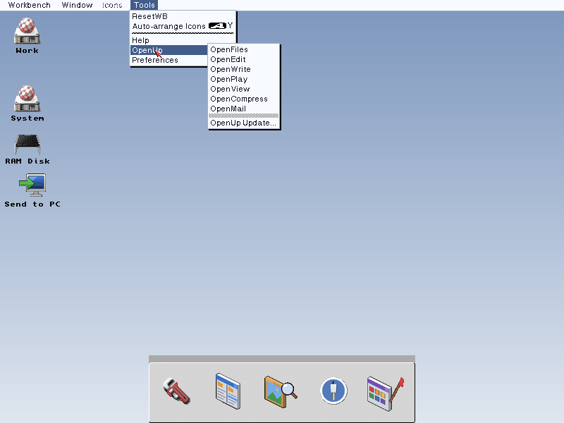

# OpenUp

Install AmigaOS 3.2.3, run OpenUp, and it's ready to boot on a real Amiga, a PiStorm or the AmigaChrome appliance. We, 4 October 2026: "install 3.2.3, run our pack", "and it's ready to boot on a PiStorm, our appliance, real Amiga"; "OpenUp it is".

Status, 5 October 2026: **OpenUp 0.1 is built, for AmigaChrome instances**
(phase 1, plus OpenLook). It installs OpenSocket, OpenPrint and OpenView,
AmigaChrome's sharing tools, OpenLook and the background pack, and its uninstaller puts the system
back exactly as it was: validated on a scratch OS 3.2.3 instance
(`docs/history/VALIDATION.md`).

OpenUp's programs and their settings are in Workbench's Tools menu, under
OpenUp and Preferences (`src/openupmenu.c`, `DESIGN.md` section 7):

**Building it:** `python3 tools/build_pack.py --lha` builds every part with
its own repository's scripts (checkouts beside this one, or given with
`--amigachrome`, `--openamigaprint`, `--opengadtools`, `--guest`) and makes
`build/pack/OpenUp/` and `OpenUp-0.1.lha`. On the Amiga, double-click
Install-OpenUp in the drawer. Without an AmigaChrome install on the build
machine, point the icon writer at the amigachrome repository:
`ACBUILD_ICON_JS=<amigachrome>/launcher/acbuild-tools/amiga-icon.js` and
`BOXIE_ICONS=<amigachrome>/resources/icons/collections/boxie`. `DESIGN.md` is the design. Section 6 takes in a lot of what AmiKit tries to be: an Amiga that is beautiful and ready the moment it starts, with first-boot Setup, startup switches, themes and free updates.

Part of the Open family (internally, the Great Open Source Reunification
Project): one platform, AmigaOS 3.2.x with the Open libraries, that is easy
to set up, and to build and port for.

## Licence

MIT, Copyright (c) 2026 AmigaChrome Team (`LICENSE`), for our own files.
Third-party code keeps its own licence (see `DESIGN.md`).

If you use or build on this work, we ask (we do not require) that you credit
the AmigaChrome Team, for example "based on OpenUp by Dalsin
Limited".

## Contributors

OpenUp is created and maintained by [SacredTrees](https://github.com/SacredTrees) with The AmigaChrome Team, copyright AmigaChrome Team. Everyone whose work it includes is credited in [`CONTRIBUTORS.md`](CONTRIBUTORS.md).
